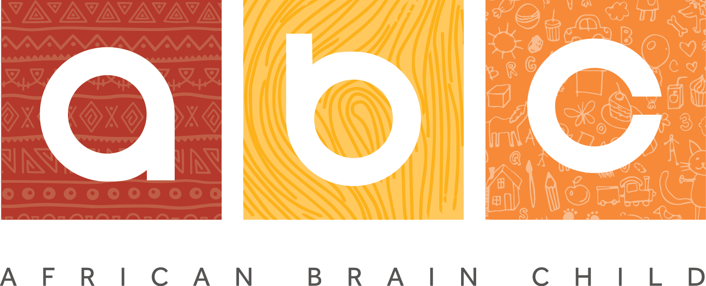
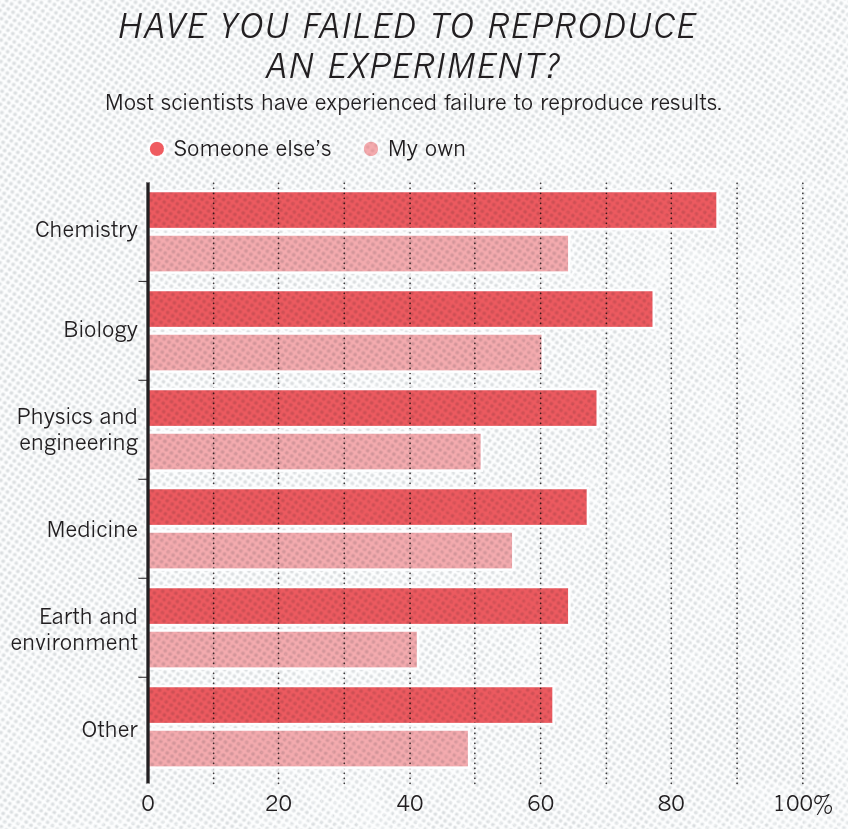
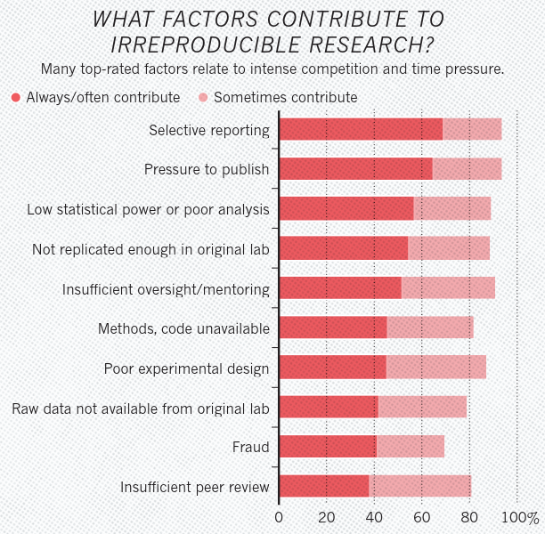
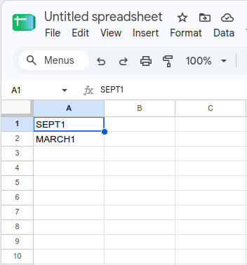
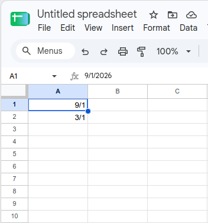
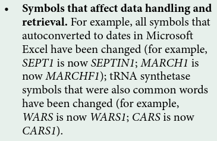
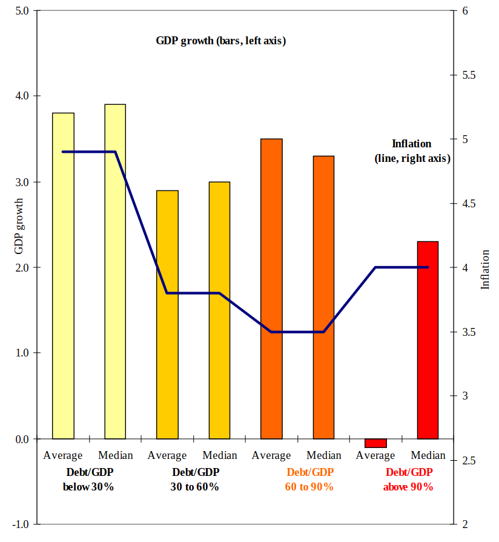

```{r}
#| include: false
library(qrcode)
```

```{r}
#| include: false
source("R/gauge.R")
```


## Personal experience

<br>
<br>

::: {.fragment}
::: {.center-container}
::: {.icon-wrapper}

:::
::: {.takehome-card}
::: {.fragment}
- Science is hard. 
:::
::: {.fragment}
- We aren't always kind to our future selves. 
:::
::: {.fragment}
- It is even harder to be kind to those who follow us.
:::
:::
:::
:::

::: {.notes}
In this session, we're going to go on a journey together before we actually get to R.

Let's start right here in this room. 

Raise your hand if you've ever opened up your own project notes, your notebook, or your lab notebook for an old analysis or project ... and found that you couldn't recreate the results or even the workflow?

Does anyone want to briefly share about that experience?

Now, raise your hand if you've tried to recreate the results or workflow from someone else, but failed to do so. 

Does anyone want to share briefly about that?
:::


## Scientific credibility

<br>
<br>

::: {.center-container}
::: {.icon-wrapper}

:::
::: {.definition-card}
[credibility]{.def-term} — trust placed in an institution / researcher / group / finding by the scientific community and the public
:::
:::

::: {.notes}
Let's think about the field of scientific research as an institution. For the public to place their trust in science, what percentage of studies do you think should be possible to reproduce or replicate?

Of the study replications and reproductions that have been attempted to date, what percentage do you think have been successful?
:::

{.absolute top="5" right="40" width="200"}

::: footer
African Brain Child | Neurosciences Institute | UCT
:::


## Interactive responses

<br>
<br>
<br>

```{r}
#| echo: false
#| fig-align: center
#| out-width: "75%"
library(qrcode)
qr <- qr_code("https://docs.google.com/forms/d/e/1FAIpQLScoCB8qP_F7_PQibXlbrCcta610dhzCR0mNN62F40K2f-iTGQ/viewform?usp=publish-editor")
plot(qr)
```

::: {.notes}

:::

{.absolute top="5" right="40" width="200"}

::: footer
African Brain Child | Neurosciences Institute | UCT
:::


## Ideal replication / reproduction rate?

<br>
<br>
<br>
<br>
<br>

```{r}
live_gauge("plotCredibility")
```

::: {.notes}
These are your speaker notes. They will be hidden during the presentation but will appear in the rendered HTML notes document and when pressing `S` in the reveal.js presentation.
:::

{.absolute top="5" right="40" width="200"}

::: footer
African Brain Child | Neurosciences Institute | UCT
:::


## Actual replication / reproduction rate?

<br>
<br>
<br>
<br>
<br>

```{r}
live_gauge("plotActual")
```

::: {.notes}
These are your speaker notes. They will be hidden during the presentation but will appear in the rendered HTML notes document and when pressing `S` in the reveal.js presentation.
:::

{.absolute top="5" right="40" width="200"}

::: footer
African Brain Child | Neurosciences Institute | UCT
:::


## Reliability matrix

:::: {.mx-stage}


::: {.mx-cell .fragment fragment-index=1 style="left:200px; top:120px;"}
:::
::: {.mx-cell .fragment fragment-index=1 style="left:600px; top:120px;"}
:::
::: {.mx-cell .fragment fragment-index=1 style="left:200px; top:520px;"}
:::
::: {.mx-cell .fragment fragment-index=1 style="left:600px; top:520px;"}
:::

::: {.mx-axis-title .fragment fragment-index=2 style="left:500px; top:0; width:200px;"}
Data
:::
::: {.mx-axis-label .fragment fragment-index=2 style="left:300px; top:35px; width:200px;"}
Same
:::
::: {.mx-axis-label .fragment fragment-index=2 style="left:700px; top:35px; width:200px;"}
New
:::
::: {.mx-cell2 .fragment fragment-index=2 .fade-in-then-out style="left:200px; top:120px;"}
:::

::: {.mx-cell2 .fragment fragment-index=2 .fade-in-then-out style="left:600px; top:120px;"}
:::

::: {.mx-axis-title .fragment fragment-index=3 style="left:0; top:400px; height:200px;"}
Analysis /<br>code
:::
::: {.mx-axis-label .fragment fragment-index=3 style="left:50px; top:200px; height:100px;"}
Same
:::
::: {.mx-axis-label .fragment fragment-index=3 style="left:50px; top:700px; height:100px;"}
New
:::
::: {.mx-cell3 .fragment fragment-index=3 .fade-in-then-out style="left:200px; top:120px;"}
:::
::: {.mx-cell3 .fragment fragment-index=3 .fade-in-then-out style="left:200px; top:520px;"}
:::

::: {.mx-cell .fragment fragment-index=4 style="left:200px; top:120px; border: 4px solid #f48c1f;"}
Same data,<br>same code
:::
::: {.mx-cell .fragment fragment-index=5 style="left:600px; top:120px; border: 4px solid #f48c1f;"}
New data,<br>same code
:::
::: {.mx-cell .fragment fragment-index=6 style="left:200px; top:520px; border: 4px solid #f48c1f;"}
Same data,<br>new code
:::
::: {.mx-cell .fragment fragment-index=7 style="left:600px; top:520px; border: 4px solid #f48c1f;"}
New data,<br>new code
:::

<!-- Step 1: cards appear on the right (fragment-index 1-4) -->
<!-- Step 2: cards move into the matrix one at a time (fragment-index 5-8) -->
<!-- --dx / --dy = target position minus starting position -->

::: {.mx-axis-title .fragment fragment-index=8 style="left:1110px; top:0; width:200px;"}
Result
:::

::: {.mx-slot .fragment fragment-index=9 style="left:1060px; top:90px;"}
::: {.mx-card .fragment .mx-move fragment-index=15 style="--dx:-810px; --dy:580px; background:#c45426;"}
Robust
:::
:::

::: {.mx-slot .fragment fragment-index=10 style="left:1060px; top:310px;"}
::: {.mx-card .fragment .mx-move fragment-index=14 style="--dx:-410px; --dy:-35px; background:#ffb217;"}
Replicable
:::
:::

::: {.mx-slot .fragment fragment-index=11 style="left:1060px; top:530px;"}
::: {.mx-card .fragment .mx-move fragment-index=13 style="--dx:-810px; --dy:-255px; background:#2d2d2e;"}
Reproducible
:::
:::

::: {.mx-slot .fragment fragment-index=12 style="left:1060px; top:750px;"}
::: {.mx-card .fragment .mx-move fragment-index=16 style="--dx:-410px; --dy:-80px; background:#b3382b;"}
Generalizable
:::
:::

::::

::: {.notes}
Flanagan, J. 2025. Reproducibility, replicability, robustness, and generalizability in corpus linguistics. International Journal of Corpus Linguistics 30(2):130-149. https://doi.org/10.1075/ijcl.24113.fla 
:::

{.absolute top="5" right="40" width="200"}

::: footer
African Brain Child | Neurosciences Institute | UCT
:::


## Reproducibility, gene expression studies

18 papers<br>
<b>Same data</b> (public datasets)<br>
<b>Same code</b> (original analytical pipeline)

:::: {.columns}

::: {.column width="50%"}
::: {.fragment data-gauge="plotIoannidis2009"}
```{r}
live_gauge("plotIoannidis2009")
```
:::
:::


::: {.column width="50%"}
::: {.fragment data-gauge="plotIoannidis2009you"}
```{r}
live_gauge("plotIoannidis2009you")
```
:::
:::

::::

::: {.reference-container}
::: {.icon-wrapper}

:::
::: {.reference-card}
Ioannidis, J., Allison, D., Ball, C. et al. Repeatability of published microarray gene expression analyses. <em><b>Nat Genet 41</b></em>, 149–155 (2009). https://doi.org/10.1038/ng.295
:::
:::


::: {.notes}

:::

{.absolute top="5" right="40" width="200"}

::: footer
African Brain Child | Neurosciences Institute | UCT
:::


## Replicability, oncology drug target studies

67 projects<br>
<b>New data</b> (new in-house wet-lab assays)<br>
<b>Mixed code</b> (21% same code, 67% adapted models or assays)

:::: {.columns}

::: {.column width="50%"}
::: {.fragment data-gauge="plotPrinz2011"}
```{r}
live_gauge("plotPrinz2011")
```
:::
:::

::: {.column width="50%"}
::: {.fragment data-gauge="plotPrinz2011you"}
```{r}
live_gauge("plotPrinz2011you")
```
:::
:::

::::


::: {.reference-container}
::: {.icon-wrapper}

:::
::: {.reference-card}
Prinz, F., Schlange, T. & Asadullah, K. Believe it or not: how much can we rely on published data on potential drug targets?. <em><b>Nat Rev Drug Discov 10</b></em>, 712 (2011). https://doi.org/10.1038/nrd3439-c1
:::
:::


::: {.notes}

:::

{.absolute top="5" right="40" width="200"}

::: footer
African Brain Child | Neurosciences Institute | UCT
:::


## Replicability, preclinical cancer research studies

53 papers<br>
<b>New data</b> (new cell / animal models)<br>
<b>Mixed code</b> (Same protocols / reagents, some adapted models)

:::: {.columns}

::: {.column width="50%"}
::: {.fragment data-gauge="plotBegley2012"}
```{r}
live_gauge("plotBegley2012")
```
:::
:::

::: {.column width="50%"}
::: {.fragment data-gauge="plotBegley2012you"}
```{r}
live_gauge("plotBegley2012you")
```
:::
:::

::::


::: {.reference-container}
::: {.icon-wrapper}

:::
::: {.reference-card}
Begley, C., Ellis, L. Raise standards for preclinical cancer research. <em><b>Nature 483</b></em>, 531–533 (2012). https://doi.org/10.1038/483531a
:::
:::


::: {.notes}

:::

{.absolute top="5" right="40" width="200"}

::: footer
African Brain Child | Neurosciences Institute | UCT
:::


## Replicability, psychology studies

100 papers<br>
<b>New data</b> (new participants)<br>
<b>Same code</b> (original materials and protocols)

::: {.fragment data-gauge="plotOSC2015"}
```{r}
live_gauge("plotOSC2015")
```
:::

::: {.reference-container}
::: {.icon-wrapper}

:::
::: {.reference-card}
Open Science Collaboration, Estimating the reproducibility of psychological science. <em><b>Science 349</b></em>, aac4716 (2015). DOI:10.1126/science.aac4716
:::
:::


::: {.notes}

:::

{.absolute top="5" right="40" width="200"}

::: footer
African Brain Child | Neurosciences Institute | UCT
:::


## Replicability, other fields

47 papers, scoping review (health sciences, economics, biomedicine, education)<br>
<b>Mixed data</b> (20% re-analysis, ~80% some new trials)<br>
<b>Mixed code</b> (some re-analysis, some adapted protocols)


:::: {.columns}

::: {.column width="25%"}
::: {.fragment data-gauge="plotCobey2023health"}
```{r}
live_gauge("plotCobey2023health")
```
:::
:::

::: {.column width="25%"}
::: {.fragment data-gauge="plotCobey2023economics"}
```{r}
live_gauge("plotCobey2023economics")
```
:::
:::

::: {.column width="25%"}
::: {.fragment data-gauge="plotCobey2023biomedicine"}
```{r}
live_gauge("plotCobey2023biomedicine")
```
:::
:::

::: {.column width="25%"}
::: {.fragment data-gauge="plotCobey2023education"}
```{r}
live_gauge("plotCobey2023education")
```
:::
:::
::::


::: {.reference-container}
::: {.icon-wrapper}

:::
::: {.reference-card}
Cobey, KD et al. (2023) Epidemiological characteristics and prevalence rates of research reproducibility across disciplines: A scoping review of articles published in 2018-2019 <em><b>eLife 12</b></em>:e78518. https://doi.org/10.7554/eLife.78518 
:::
:::


::: {.notes}

:::

{.absolute top="5" right="40" width="200"}

::: footer
African Brain Child | Neurosciences Institute | UCT
:::


## >1,500 scientists interviewed

<em><b>Nature</b></em> surveyed 1,576 researchers<br>
about reproducing or replicating<br>
their own or other's research

:::: {.columns}

::: {.column width="50%"}
::: {.fragment data-gauge="plotBaker2016others"}
```{r}
live_gauge("plotBaker2016others")
```
:::
:::

::: {.column width="50%"}
::: {.fragment data-gauge="plotBaker2016own"}
```{r}
live_gauge("plotBaker2016own")
```
:::
:::

::::

::: {.reference-container}
::: {.icon-wrapper}

:::
::: {.reference-card}
Baker, M. 1,500 scientists lift the lid on reproducibility. <em><b>Nature 533</b></em>, 452–454 (2016). https://doi.org/10.1038/533452a
:::
:::

::: {.notes}

:::

{.absolute top="5" right="40" width="200"}

::: footer
African Brain Child | Neurosciences Institute | UCT
:::


## >1,500 scientists interviewed 2

::: {.fullimage-container}
::: {.fragment}

:::
:::

::: {.reference-container}
::: {.icon-wrapper}

:::
::: {.reference-card}
Baker, M. 1,500 scientists lift the lid on reproducibility. <em><b>Nature 533</b></em>, 452–454 (2016). https://doi.org/10.1038/533452a
:::
:::

::: {.notes}

:::

{.absolute top="5" right="40" width="200"}

::: footer
African Brain Child | Neurosciences Institute | UCT
:::


## What contributes to the problem?

::: {.fullimage-container}
::: {.fragment}

:::
:::

::: {.reference-container}
::: {.icon-wrapper}

:::
::: {.reference-card}
Baker, M. 1,500 scientists lift the lid on reproducibility. <em><b>Nature 533</b></em>, 452–454 (2016). https://doi.org/10.1038/533452a
:::
:::

::: {.notes}

:::

{.absolute top="5" right="40" width="200"}

::: footer
African Brain Child | Neurosciences Institute | UCT
:::


## Issues

::: {.fragment}
::: {.full-container}
::: {.icon-wrapper}

:::
::: {.full-card}

:::: {.hl-stage}

:::: {.columns}

::: {.column width="25%"}

::: {.fragment}
<b>Statistics, design</b>
:::
::: {.fragment}
- [Low statistical power]{.cause data-prevent="5" data-mitigate="3"}
:::
::: {.fragment}
- [Researcher degrees of freedom / analytic flexibility]{.cause data-expose="1 2" data-mitigate="3"}
:::
::: {.fragment}
- [<em>p</em>-hacking]{.cause data-mitigate="3"}
:::
::: {.fragment}
- [HARKing]{.cause data-prevent="3" data-expose="2"}
:::
::: {.fragment}
- [Misuse and misinterpretation of <em>p</em>-values]{.cause data-mitigate="5"}
:::
::: {.fragment}
- [Pseudoreplication]{.cause data-expose="1" data-prevent="5"}
:::
::: {.fragment}
- [Unit-of-analysis errors]{.cause data-expose="1" data-prevent="5"}
:::
::: {.fragment}
- [Low prior probability]{.cause data-mitigate="5"}
:::
::: {.fragment}
- [Analytic variability]{.cause data-expose="1" data-mitigate="5"}
:::
::: {.fragment}
<b>Publication, reporting</b>
:::
::: {.fragment}
- [File drawer problem]{.cause data-mitigate="3 6"}
:::

:::

::: {.column width="25%"}

::: {.fragment}
- [Publication bias]{.cause data-mitigate="3 6"}
:::
::: {.fragment}
- [Outcome switching]{.cause data-prevent="3" data-expose="2"}
:::
::: {.fragment}
- [Selective outcome reporting]{.cause data-prevent="3" data-mitigate="5"}
:::
::: {.fragment}
- [Spin & positive-result inflation]{.cause data-mitigate="3 5"}
:::
::: {.fragment}
- [Reporting errors]{.cause data-prevent="1" data-expose="4"}
:::
::: {.fragment}
- [Insufficient methodological detail]{.cause data-mitigate="1 4 5"}
:::
::: {.fragment}
<b>Incentives, culture</b>
:::
::: {.fragment}
- [Publish or perish]{.cause data-mitigate="6"}
:::
::: {.fragment}
- [Novelty bias]{.cause data-mitigate="3 6"}
:::
::: {.fragment}
- [Questionable research practices]{.cause data-mitigate="6"}
:::
::: {.fragment}
- [Fraud]{.cause data-expose="4"}
:::
::: {.fragment}
- [Poor training & mentoring]{.cause data-mitigate="6"}
:::

:::

::: {.column width="25%"}


::: {.fragment}
<b>Transparency, infrastructure</b>
:::
::: {.fragment}
- [Data & code not shared]{.cause data-prevent="4"}
:::
::: {.fragment}
- [Code that doesn't run]{.cause data-mitigate="2" data-expose="4"}
:::
::: {.fragment}
- [Undocumented analysis steps]{.cause data-prevent="1 2"}
:::
::: {.fragment}
- [Manual, untraceable edits]{.cause data-prevent="1"}
:::
::: {.fragment}
- [Quality of materials & reagents]{.cause data-mitigate="4"}
:::
::: {.fragment}
<b>Other</b>
:::
::: {.fragment}
- [Poor measurement validity]{.cause data-gap="7"}
:::
::: {.fragment}
- [Weak theory]{.cause data-gap="7"}
:::
::: {.fragment}
- [Hidden / lurking variables (confounders)]{.cause data-mitigate="5"}
:::
::: {.fragment}
- [True heterogeneity]{.cause data-gap="7"}
:::

:::

::: {.column width="25%"}


::: {.fragment}
<b>Solutions</b>
:::
::: {.fragment}
1. [Analsysis as code]{.cause data-sol="1"}
:::
::: {.fragment}
2. [Version control & env. mgt.]{.cause data-sol="2"}
:::
::: {.fragment}
3. [Preregistration]{.cause data-sol="3"}
:::
::: {.fragment}
4. [Open data, code, materials]{.cause data-sol="4"}
:::
::: {.fragment}
5. [Better design, statistics, reporting]{.cause data-sol="5"}
:::
::: {.fragment}
6. [Culture, incentives, training]{.cause data-sol="6"}
:::
::: {.fragment}
7. [Other]{.cause data-sol="7"}
:::
::: {.fragment}
<br>
<br>
<b>Impact</b>
:::
::: {.fragment}
[Prevents]{.cause data-prevent="1 2 3 4 5 6 7"}
:::
::: {.fragment}
[Mitigates]{.cause data-mitigate="1 2 3 4 5 6 7"}
:::
::: {.fragment}
[Exposes]{.cause data-expose="1 2 3 4 5 6 7"}
:::
::: {.fragment}
[Needs other work]{.cause data-gap="1 2 3 4 5 6 7"}
:::
::: {.hl-step .fragment .current-visible data-sol="1"}
:::
::: {.hl-step .fragment .current-visible data-sol="2"}
:::
::: {.hl-step .fragment .current-visible data-sol="3"}
:::
::: {.hl-step .fragment .current-visible data-sol="4"}
:::
::: {.hl-step .fragment .current-visible data-sol="5"}
:::
::: {.hl-step .fragment .current-visible data-sol="6"}
:::
::: {.hl-step .fragment .current-visible data-sol="7"}
:::


:::

::::

::::


:::
:::
:::

::: {.notes}

:::

{.absolute top="5" right="40" width="200"}

::: footer
African Brain Child | Neurosciences Institute | UCT
:::


## What can we do?


::: {.center-container}
::: {.icon-wrapper}

:::
::: {.takehome-card}


<b>Solutions</b>


::: {.sol-row}
::: {.sol-text}
Analysis as code
:::
::: {.sol-bar}
```{r}
#| echo: false
row_bar("plotanalysisascode")
```
:::
:::

::: {.sol-row}
::: {.sol-text}
Version control
:::
::: {.sol-bar}
```{r}
#| echo: false
row_bar("plotversioncontrol")
```
:::
:::

::: {.sol-row}
::: {.sol-text}
Env. mgt
:::
::: {.sol-bar}
```{r}
#| echo: false
row_bar("plotenvmgt")
```
:::
:::


::: {.sol-row}
::: {.sol-text}
Preregistration
:::
::: {.sol-bar}
```{r}
#| echo: false
row_bar("plotpreregistration")
```
:::
:::


::: {.sol-row}
::: {.sol-text}
Open data
:::
::: {.sol-bar}
```{r}
#| echo: false
row_bar("plotopendata")
```
:::
:::
 
::: {.sol-row}
::: {.sol-text}
Open code
:::
::: {.sol-bar}
```{r}
#| echo: false
row_bar("plotopencode")
```
:::
:::

::: {.sol-row}
::: {.sol-text}
Open materials
:::
::: {.sol-bar}
```{r}
#| echo: false
row_bar("plotopenmaterials")
```
:::
:::


::: {.sol-row}
::: {.sol-text}
Better design
:::
::: {.sol-bar}
```{r}
#| echo: false
row_bar("plotdesign")
```
:::
:::

::: {.sol-row}
::: {.sol-text}
Better statistics
:::
::: {.sol-bar}
```{r}
#| echo: false
row_bar("plotstatistics")
```
:::
:::

::: {.sol-row}
::: {.sol-text}
Better reporting
:::
::: {.sol-bar}
```{r}
#| echo: false
row_bar("plotreporting")
```
:::
:::


::: {.sol-row}
::: {.sol-text}
Culture
:::
::: {.sol-bar}
```{r}
#| echo: false
row_bar("plotculture")
```
:::
:::

::: {.sol-row}
::: {.sol-text}
Incentives
:::
::: {.sol-bar}
```{r}
#| echo: false
row_bar("plotincentives")
```
:::
:::

::: {.sol-row}
::: {.sol-text}
Training
:::
::: {.sol-bar}
```{r}
#| echo: false
row_bar("plottraining")
```
:::
:::

::: {.sol-row}
::: {.sol-text}
Measurement validation
:::
::: {.sol-bar}
```{r}
#| echo: false
row_bar("plotmeasurement")
```
:::
:::

::: {.sol-row}
::: {.sol-text}
Theory
:::
::: {.sol-bar}
```{r}
#| echo: false
row_bar("plottheory")
```
:::
:::

::: {.sol-row}
::: {.sol-text}
Multi-centre
:::
::: {.sol-bar}
```{r}
#| echo: false
row_bar("plotmulticentre")
```
:::
:::

::: {.sol-row}
::: {.sol-text}
Multi-study
:::
::: {.sol-bar}
```{r}
#| echo: false
row_bar("plotmultistudy")
```
:::
:::

::: {.sol-row}
::: {.sol-text}
Meta-analysis
:::
::: {.sol-bar}
```{r}
#| echo: false
row_bar("plotmetaanalysis")
```
:::
:::


:::
:::


::: {.notes}
Let's discuss what lies within our sphere of influence and what lies outside of it. 
:::

{.absolute top="5" right="40" width="200"}

::: footer
African Brain Child | Neurosciences Institute | UCT
:::


## Why code?

```{r}
row_bar("plotanalysisascode")
```

::: {.fragment}
::: {.center-container}
::: {.icon-wrapper}

:::
::: {.takehome-card}
::: {.fragment}
- Be kind the 'future you'
:::
::: {.fragment}
- Open science. Transparency
:::
::: {.fragment}
- Scalability
:::
::: {.fragment}
- Collaboration
:::
::: {.fragment}
- Automation
:::
::: {.fragment}
- Some problems specific to point-and-click workflows
:::
:::
:::
:::

::: {.notes}
One part of the solution is have analysis be conducted using code which is stored, shared, version controlled, and correctly annotated.
:::

{.absolute top="5" right="40" width="200"}

::: footer
African Brain Child | Neurosciences Institute | UCT
:::


## Gene name errors

:::: {.columns}

::: {.column width="33%"}
::: {.fragment}

:::
:::

::: {.column width="33%"}
::: {.fragment}

:::
:::

::: {.column width="33%"}
::: {.fragment}

:::
:::

::::


::: {.reference-container}
::: {.icon-wrapper}

:::
::: {.reference-card}
- Ziemann, M., Eren, Y., & El-Osta, A. (2016). Gene name errors are widespread in the scientific literature. <em><b>Genome biology, 17</b></em>(1), 177. https://doi.org/10.1186/s13059-016-1044-7
- Abeysooriya, M., Soria, M., Kasu, M. S., & Ziemann, M. (2021). Gene name errors: Lessons not learned. <em><b>PLoS computational biology, 17</b></em>(7), e1008984. https://doi.org/10.1371/journal.pcbi.1008984
- Bruford, E.A., Braschi, B., Denny, P. <em>et al</em>. Guidelines for human gene nomenclature. <em><b>Nat Genet 52</b></em>, 754–758 (2020). https://doi.org/10.1038/s41588-020-0669-3
:::
:::


::: {.notes}
Human Genome Organization (HUGO). HUGO Gene Nomenclature Committee (HGNC). Changed 27 gene names. Excel gene-name errors (e.g., SEPT2 became a date) affected about 1 in 5 genomics papers with supplementary gene lists (Ziemann et al., 2016)
:::

{.absolute top="5" right="40" width="200"}

::: footer
African Brain Child | Neurosciences Institute | UCT
:::


## COVID and NHS contact tracing

::: {.fragment}
::: {.center-container}
::: {.icon-wrapper}

:::
::: {.takehome-card}
::: {.fragment}
- CSV file conversion
:::
::: {.fragment}
- ~16,000 positive COVID cases missed
:::
::: {.fragment}
- Contact tracing for ~50,000 people delayed
:::
::: {.fragment}
- Transmission believed to be flat
:::
:::
:::
:::

::: {.notes}

:::

{.absolute top="5" right="40" width="200"}

::: footer
African Brain Child | Neurosciences Institute | UCT
:::


## Economics and austerity measures


::: {.reference-container}
::: {.icon-wrapper}

:::
::: {.reference-card}
- Carmen M. Reinhart & Kenneth S. Rogoff, 2010. Growth in a Time of Debt, <em><b>American Economic Review 100</b></em>(2), p. 573-578
- Herndon, Thomas, Ash, Michael and Pollin, Robert, (2014), Does high public debt consistently stifle economic growth? A critique of Reinhart and Rogoff, <em><b>Cambridge Journal of Economics, 38</b></em>, issue 2, p. 257-279
:::
:::


::: {.notes}

:::

{.absolute top="5" right="40" width="200"}

::: footer
African Brain Child | Neurosciences Institute | UCT
:::


## Economics and austerity measures 2

::: {.fullimage-container}
::: {.fragment}

:::
:::


::: {.notes}
5 out of 20 selected countries were ommited when using the AVERAGE function (Australia, Austria, Belgium, Canada, and Denmark). The rest were Finland, France, Germany, Greece, Ireland, Italy, Japan,
Netherlands, New Zealand, Norway, Portugal, Spain, Sweden, the United Kingdom, and the United States.
:::

{.absolute top="5" right="40" width="200"}

::: footer
African Brain Child | Neurosciences Institute | UCT
:::


## Why NOT code?

::: {.fragment}
::: {.center-container}
::: {.icon-wrapper}

:::
::: {.takehome-card}
::: {.fragment}
- Investment of time
:::
::: {.fragment}
- Dedicated workflows and infrastructure
:::
::: {.fragment}
- Collaborators use Excel or SPSS
:::
:::
:::
:::

::: {.notes}
There are legitimate reasons that prevent people from learning to code or adopting the general practice.
:::

{.absolute top="5" right="40" width="200"}

::: footer
African Brain Child | Neurosciences Institute | UCT
:::


## What can code NOT fix?

::: {.fragment}
::: {.center-container}
::: {.icon-wrapper}

:::
::: {.takehome-card}
::: {.fragment}
- Poor study design
:::
::: {.fragment}
- Poor data
:::
::: {.fragment}
- Unshared data
:::
::: {.fragment}
- Wrong code
:::
:::
:::
:::

::: {.notes}
There are legitimate reasons that prevent people from learning to code or adopting the general practice.
:::

{.absolute top="5" right="40" width="200"}

::: footer
African Brain Child | Neurosciences Institute | UCT
:::


## Why R?

<br>
<br>

::: {.fragment}
::: {.center-container}
::: {.icon-wrapper}

:::
::: {.takehome-card}
::: {.fragment}
- Just 1 of many options. In many cases, R isn't the best
:::
::: {.fragment}
- Documentation
:::
::: {.fragment}
- Many peer-reviewed packages and functions
:::
::: {.fragment}
- Open-source
:::
::: {.fragment}
- Community and support
:::
::: {.fragment}
- What is the norm in your field?
:::
:::
:::
:::

::: {.notes}
R is one of many options for data analysis. Globally, python is more popular, particularly with people who have a computer science background or who are doing machine learning. R is more popular in academic circles (though python is catching up). Other options like Julia and Matlab are more niche but may be the best options for a specific application. R is particularly good because many of the functions, packages, and algorithms available have associated peer reviewed publications. The code is also open source, so one can verify internals if one wants to. All packages have documentation. There is a wide base of community support and some commercial support (like Posit). R is also particularly good for research-grade graphics.
:::

{.absolute top="5" right="40" width="200"}

::: footer
African Brain Child | Neurosciences Institute | UCT
:::


## R as part of an ecosystem

...

::: {.notes}
R fits well into a broader ecosystem whereby analysis code (R) sits alongside presentation code (LaTeX, Quarto, md, etc) so that code, output, text, figures all sit within a single document that can produce reports, journal articles, presentations, web pages, and several other output formats.
:::

{.absolute top="5" right="40" width="200"}

::: footer
African Brain Child | Neurosciences Institute | UCT
:::


## Next steps

...

::: {.notes}
.
:::

{.absolute top="5" right="40" width="200"}

::: footer
African Brain Child | Neurosciences Institute | UCT
:::


## Normal Slide Title

...

::: {.notes}
These are your speaker notes. They will be hidden during the presentation but will appear in the rendered HTML notes document and when pressing `S` in the reveal.js presentation.
:::

{.absolute top="5" right="40" width="200"}

::: footer
African Brain Child | Neurosciences Institute | UCT
:::


